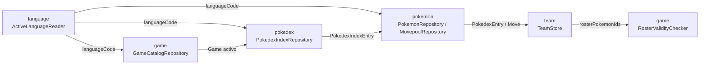

# Data Model: Migración de BrewDex a Angular

Todos los tipos son TypeScript puro (`web/src/<módulo>/domain/**`), sin imports de Angular ni de HTTP (Constitución, Principio VI). Ninguno lleva `toJson`/`fromJson`: al no haber persistencia (FR-015, [[research.md]] Decisión 5), la (de)serialización que la versión Flutter usaba para `shared_preferences` no tiene equivalente en esta migración.

La organización es por módulo primero ([[research.md]] Decisión 11): `language`, `game`, `pokemon`, `pokedex`, `team`.

## Módulo `language`

### `SupportedLanguage` (value object)

| Campo | Tipo | Notas |
|---|---|---|
| `code` | `string` | Código oficial de idioma de PokeAPI (p. ej. `"es"`, `"zh-Hans"`). Clave de identidad/igualdad. |
| `displayName` | `string` | Nombre visible, nunca el código crudo (FR-002). |

Igualdad por `code` únicamente.

### Estado de aplicación (no persistido)

`LanguageStore` (servicio de aplicación, signals):

| Signal | Tipo | Notas |
|---|---|---|
| `activeLanguageCode` | `Signal<string>` | Resuelto al iniciar la app: idioma del navegador si está soportado, si no un idioma por defecto (`en`) — FR-003. Cambia solo por una selección explícita durante la sesión; nunca se lee ni se escribe de ningún almacenamiento. |
| `supportedLanguages` | `Signal<SupportedLanguage[]>` | Cargado una vez desde `SupportedLanguageCatalog` al iniciar. |

## Módulo `game`

### `Generation` (value object)

| Campo | Tipo | Notas |
|---|---|---|
| `id` | `string` | Id estable de la fuente (p. ej. `"generation-i"`). Clave de igualdad. |
| `label` | `string` | Etiqueta localizada para el filtro. |

### `GameDlc` (value object)

| Campo | Tipo | Notas |
|---|---|---|
| `id` | `string` | Id estable (nombre de version-group de PokeAPI para el DLC). Clave de igualdad. |
| `displayName` | `string` | Etiqueta visible. |

### `Game` (entidad)

| Campo | Tipo | Notas |
|---|---|---|
| `id` | `string` | Id estable del catálogo. Clave de igualdad de identidad de negocio (no forma parte de `props` de comparación estructural salvo por convención heredada). |
| `displayName` | `string` | Debe distinguir el juego de cualquier otro del catálogo (FR-005) — un lanzamiento conjunto de dos versiones es **un solo** `Game`. |
| `generation` | `Generation` | Usado para el filtro por generación (FR-004). |
| `dlcs` | `GameDlc[]` | Vacío si el juego no tiene expansiones. |

### `TeamBuildingSession` (entidad, en memoria, sesión-scoped)

| Campo | Tipo | Notas |
|---|---|---|
| `activeGame` | `Game \| null` | `null` hasta que la persona elige un juego. |
| `rosterPokemonIds` | `string[]` | Proyección de solo-identidad del roster actual, usada para reconciliar contra `RosterValidityChecker` al cambiar de juego (FR-016). |

### Estado de aplicación (no persistido)

`GameStore` (servicio de aplicación, signals):

| Signal | Tipo | Notas |
|---|---|---|
| `catalog` | `Signal<Game[]>` | Catálogo completo, cargado una vez por sesión, re-cargado si cambia el idioma activo (nombres localizados). |
| `activeGame` | `Signal<Game \| null>` | Vacío al iniciar (FR-015) — nunca se lee de almacenamiento. |
| `activeDlcIds` | `Signal<ReadonlySet<string>>` | DLCs activos del juego actual; se reinicia al cambiar de juego. |

## Módulo `pokemon`

Datos y reglas a nivel de especie/forma — reutilizables tanto por `pokedex` (navegación) como por `team` (roster), sin `presentation/` propio ([[research.md]] Decisión 11).

### `PokemonType` (value object)

| Campo | Tipo | Notas |
|---|---|---|
| `id` | `string` | Id estable (p. ej. `"rock"`). Clave de igualdad. |
| `label` | `string` | Etiqueta localizada. |
| `numericId` | `number` | Id numérico de PokeAPI, usado para resolver el ícono de tipo; `0` cuando no se resolvió. |

### `PokemonStats` (value object)

Seis enteros no negativos: `hp`, `attack`, `defense`, `specialAttack`, `specialDefense`, `speed`.

### `Move` (value object)

| Campo | Tipo | Notas |
|---|---|---|
| `id` | `string` | Nombre de PokeAPI — identidad e igualdad. Es lo que persistiría `RosterEntry.moveIds` (módulo `team`) si hubiera persistencia (no la hay). |
| `displayName` | `string` | Localizado, fallback inglés. |
| `type` | `PokemonType` | Tipo propio del movimiento. |
| `damageClass` | `'physical' \| 'special' \| 'status'` | Ver "Regla de dominio: `damageClass` por generación" abajo — no es un campo plano de PokeAPI para las generaciones I-III. |
| `pp` | `number` | PP base. |
| `power` | `number \| null` | `null` para un movimiento de clase `'status'` — nunca `0` como sentinela. |
| `description` | `string` | Texto de sabor/efecto, localizado con fallback inglés. |

#### Regla de dominio: `damageClass` por generación

Desde la 1ª hasta la 3ª generación, el juego no exponía la clase de un movimiento como un dato propio: todo movimiento que no fuera de estado era `'physical'` o `'special'` según el **tipo** del movimiento (una tabla fija tipo→clase), y los movimientos que a partir de la 4ª generación pasaron a ser de clase `'status'` no pertenecían a ninguna clase en esas tres primeras generaciones (no existía la noción de "clase estado" todavía). Desde la 4ª generación en adelante, `damageClass` es un dato explícito de PokeAPI (`move.damage_class`), independiente del tipo.

En consecuencia, resolver `Move.damageClass` para un `Game` de generación I-III requiere aplicar la tabla tipo→clase histórica en la capa de infraestructura (módulo `pokemon`, [[contracts/pokemon.md]]) en vez de leer un campo — PokeAPI no publica esta tabla como tal, así que se traslada como una constante hand-maintained, en el mismo espíritu que `_regionalFormSuffixByGameId`/`kMegaEvolutionEnabledGameIds` ([[research.md]] Decisión 4):

| Clase histórica (Gen. I-III) | Tipos |
|---|---|
| `'physical'` | Normal, Lucha, Volador, Veneno, Tierra, Roca, Bicho, Fantasma, Acero |
| `'special'` | Fuego, Agua, Planta, Eléctrico, Psíquico, Hielo, Dragón, Siniestro |

> Atribución: la explicación de esta regla histórica (clase oculta por tipo en Gen. I-III; los movimientos de estado moderno "no pertenecían a ninguna clase" en esas generaciones) proviene de [WikiDex](https://www.wikidex.net) y se reproduce aquí con atribución a sus autores conforme a su licencia (CC BY-SA) — no copiar este contenido a un sitio que no dé la misma atribución.

### `Gender` (unión literal)

`'male' | 'female' | 'genderless'` — tres estados explícitos, sin default implícito a `'male'`.

### `SelectableForm` (value object)

| Campo | Tipo | Notas |
|---|---|---|
| `varietyId` | `string` | Identidad/igualdad. |
| `displayName` | `string` | Localizado. |
| `gameSpriteUrl` | `string \| null` | Sprite específico del juego, mostrado en el selector de forma. |
| `homeSpriteUrl` / `homeSpriteShinyUrl` / `homeSpriteFemaleUrl` / `homeSpriteShinyFemaleUrl` | `string \| null` | Sprites estilo HOME que renderiza el slot ya elegido. |
| `kind` | `'template' \| 'mega' \| 'gigamax'` | Determina si aparece en el modal de formas o como botón dedicado. |
| `requiresDlcId` | `string \| null` | `null` si es de juego base. |
| `typePrimary` | `PokemonType` | Propio de la variedad, independiente del `PokedexEntry` principal. |
| `typeSecondary` | `PokemonType \| null` | — |
| `baseStats` | `PokemonStats` | Propio de la variedad. |

### `CosmeticVariant` (value object)

| Campo | Tipo | Notas |
|---|---|---|
| `formId` | `string` | Identidad/igualdad (nombre de `pokemon-form`). |
| `displayName` | `string` | Localizado. |
| `spriteUrl` | `string \| null` | — |
| `isDefault` | `boolean` | La variante con la que arranca un slot recién agregado (nunca una elección al azar). |

### `PokedexEntry` (entidad — "un Pokémon aplicado a un juego")

| Campo | Tipo | Notas |
|---|---|---|
| `pokemonId` | `string` | Identidad de especie — identidad/igualdad. |
| `displayName` | `string` | Localizado. |
| `pokedexNumber` | `number` | Regional o nacional según la `PokedexView` (módulo `pokedex`) activa; `0` es un valor legítimo (no un sentinela). |
| `spriteUrl` | `string \| null` | Sprite de grid; `null` → placeholder en presentación. |
| `homeSpriteUrl` / `homeSpriteShinyUrl` / `homeSpriteFemaleUrl` / `homeSpriteShinyFemaleUrl` | `string \| null` | Solo para el slot de equipo ya lleno, nunca para el grid. |
| `genderRate` | `number` | `-1` = sin datos de género. |
| `hasGenderDifferences` | `boolean` | — |
| `selectableForms` | `SelectableForm[]` | Formas tipo `template` ofrecidas en el modal. |
| `megaForm` / `gigamaxForm` | `SelectableForm \| null` | Botones dedicados, excluidos del modal. |
| `cosmeticVariants` | `CosmeticVariant[]` | — |
| `typePrimary` | `PokemonType` | — |
| `typeSecondary` | `PokemonType \| null` | — |
| `introducedGeneration` | `Generation` (módulo `game`) | Usado por el filtro de generación (FR-009). |
| `sourceTag` | `PokedexEntrySource` (módulo `pokedex`) | — |
| `baseStats` | `PokemonStats` | — |

## Módulo `pokedex`

Navegación, filtrado e indexado de un Pokédex ya resuelto — depende de `pokemon` para el detalle de cada entrada, pero no al revés ([[research.md]] Decisión 11).

### `PokedexEntrySource` (unión discriminada)

```ts
type PokedexEntrySource =
  | { kind: 'regional' }
  | { kind: 'national' }
  | { kind: 'dlc'; dlcId: string };
```

### `PokedexIndexEntry` (proyección barata, solo-orden)

| Campo | Tipo |
|---|---|
| `pokemonId` | `string` |
| `pokedexNumber` | `number` |
| `sourceTag` | `PokedexEntrySource` |

### `PokedexView` (value object)

| Campo | Tipo | Notas |
|---|---|---|
| `useNationalDex` | `boolean` | Ignorado (tratado como `false`) si el juego no es elegible — ver `isNationalDexEligible` en [[research.md]] Decisión 4. |
| `activeDlcIds` | `ReadonlySet<string>` | DLCs cuyo contenido se mezcla en la lista base. |

### `PokedexFilterCriteria` (value object, aplicado en cliente)

| Campo | Tipo | Notas |
|---|---|---|
| `searchText` | `string` | Coincidencia parcial, case-insensitive, contra `PokedexEntry.displayName` (FR-009). |
| `type` | `PokemonType \| null` (módulo `pokemon`) | `null` = sin filtro de tipo. |
| `generation` | `Generation \| null` (módulo `game`) | `null` = sin filtro de generación. |

`isEmpty`: `true` cuando los tres campos están vacíos/`null`.

### Estado de aplicación (no persistido)

`PokedexStore` (servicio de aplicación, signals):

| Signal | Tipo | Notas |
|---|---|---|
| `pokedexView` | `Signal<PokedexView>` | — |
| `filterCriteria` | `Signal<PokedexFilterCriteria>` | — |
| `pokedexIndex` | `Signal<ReadonlyArray<PokedexIndexEntry>>` | Refleja el resultado de `PokedexIndexRepository.fetchPokedexIndex` para el juego/vista activos. |
| `pokedexDetailsById` | `Signal<ReadonlyMap<string, PokedexEntry>>` | Refleja `PokemonRepository.fetchPokedexDetails` (módulo `pokemon`) para las entradas visibles. |

## Módulo `team`

Construcción del equipo — consume `PokedexEntry`/`Move` de `pokemon` y `PokedexStore` de `pokedex`, pero define su propio estado de roster.

### `RosterEntry` (value object — ocupante de un slot)

| Campo | Tipo | Notas |
|---|---|---|
| `pokemonId` | `string` | Identidad de especie. |
| `formVarietyId` | `string \| null` | Presente solo si se eligió una forma no principal. |
| `gender` | `Gender \| null` (módulo `pokemon`) | `null` solo transitoriamente, mientras se resuelve. |
| `cosmeticVariantId` | `string \| null` | `null` = variante por defecto. |
| `megaActive` | `boolean` | Mutuamente excluyente con `gigamaxActive` (regla aplicada por la capa de aplicación, no por el tipo). |
| `gigamaxActive` | `boolean` | — |
| `isShiny` | `boolean` | — |
| `teraType` | `PokemonType \| null` (módulo `pokemon`) | Solo Escarlata/Púrpura; fijado una vez al agregar, cambia solo por elección explícita (nunca recalculado por un cambio de forma). |
| `moveIds` | `[string \| null, string \| null, string \| null, string \| null]` | 4 posiciones fijas; nunca el mismo id no-nulo repetido (regla de la capa de aplicación). |

### `TeamSize` (constante de dominio)

`export const MAX_TEAM_SIZE = 6;` (FR-011) — única fuente de verdad, usada tanto por la capa de aplicación (`AddPokemonToTeam`) como por la presentación (render de slots).

### Estado de aplicación (no persistido)

`TeamStore` (servicio de aplicación, signals):

| Signal | Tipo | Notas |
|---|---|---|
| `slots` | `Signal<(RosterEntry \| null)[]>` | Longitud fija `MAX_TEAM_SIZE`; se reinicia vacío al cambiar de juego (con advertencia previa, FR-016) o al recargar la app (FR-015). |

## Relaciones entre módulos



`ActiveLanguageReader` sigue siendo el único tipo del módulo `language` que otro módulo puede importar (regla ya vigente en Flutter, Constitución Principio VI — un módulo no filtra su modelo interno a otro). `RosterValidityChecker` sigue siendo un puerto que `game` declara y que se implementa usando `pokemon` (módulo `team`, ver contracts/game-catalog.md), para reconciliar el roster al cambiar de juego sin que `game` conozca el modelo interno de `pokemon`/`team`. `pokedex` y `pokemon` se mantienen separados ([[research.md]] Decisión 11): `pokedex` solo indexa/filtra, `pokemon` resuelve el detalle real de cada especie/forma.

## Transiciones de estado relevantes

- **Idioma activo**: `default (dispositivo o 'en')` → `explícito (elegido por la persona)`, dentro de la sesión únicamente; se resetea a `default` en cada carga de la app (FR-015).
- **Juego/DLC activos**: `ninguno` → `juego elegido (DLCs = ∅)` → `juego elegido (DLCs = {…})`; cambiar de juego con roster no vacío exige advertencia previa (FR-016) y, al confirmar, reconcilia el roster contra el nuevo juego vía `RosterValidityChecker`.
- **Slot de equipo**: `vacío` → `ocupado (RosterEntry por defecto: forma principal, variante por defecto, moveset por defecto)` → `ocupado (customizado)` → `vacío` (al quitarlo). Máximo `MAX_TEAM_SIZE` slots ocupados simultáneamente (FR-011).
